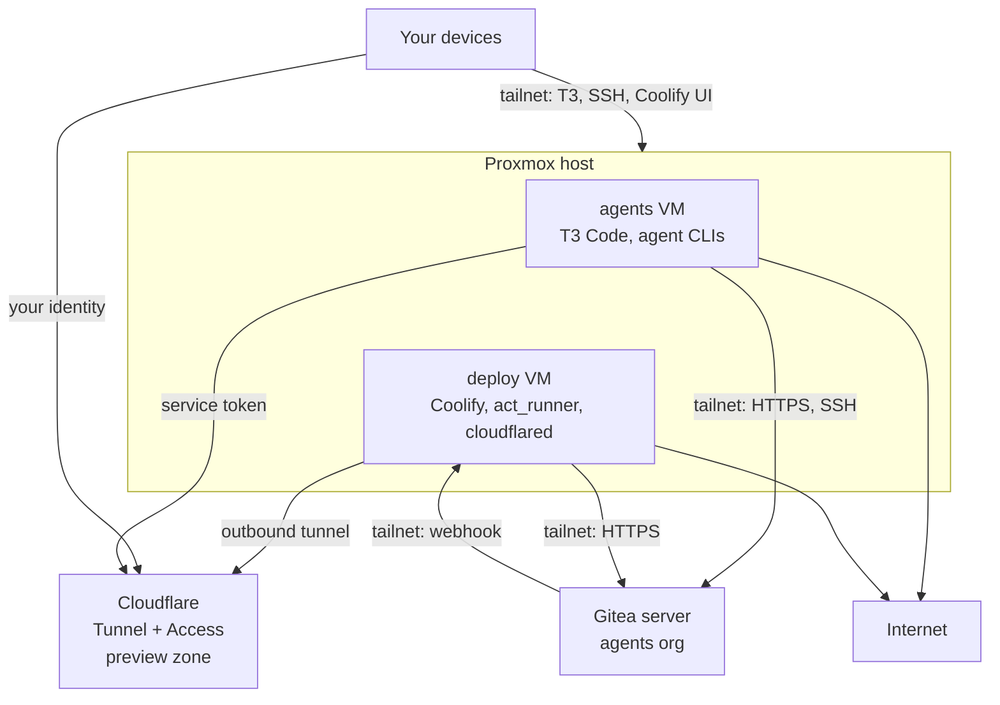
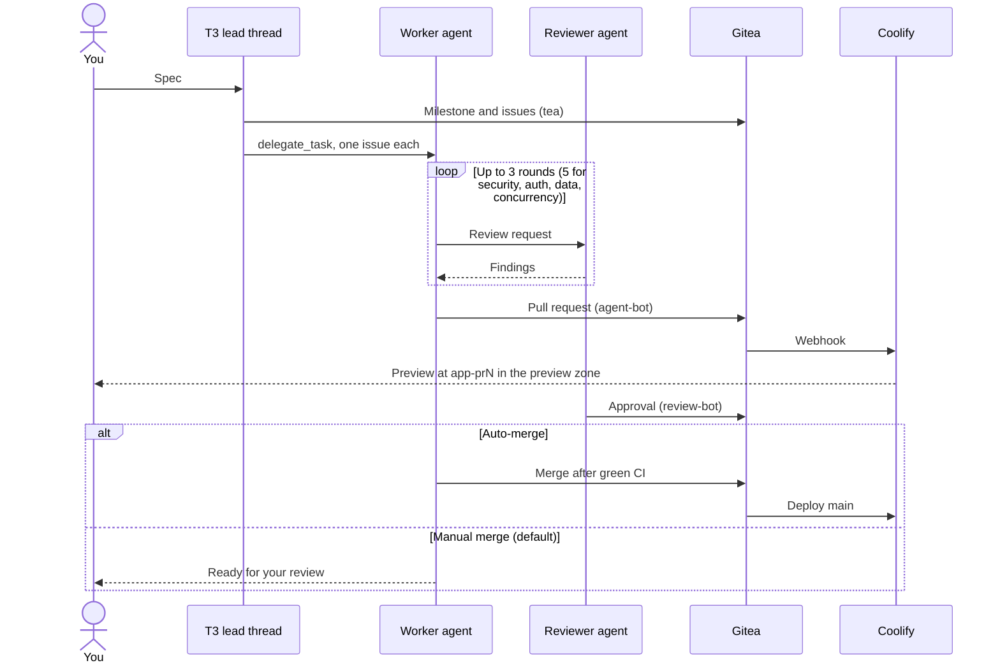
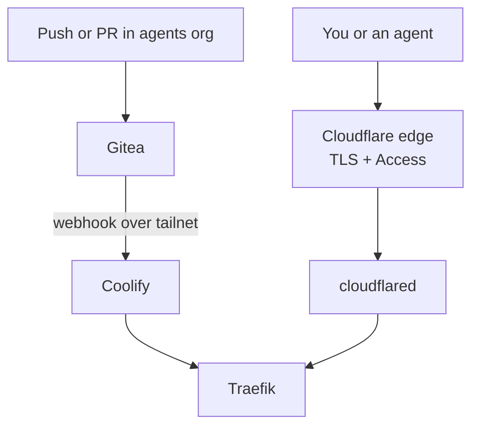
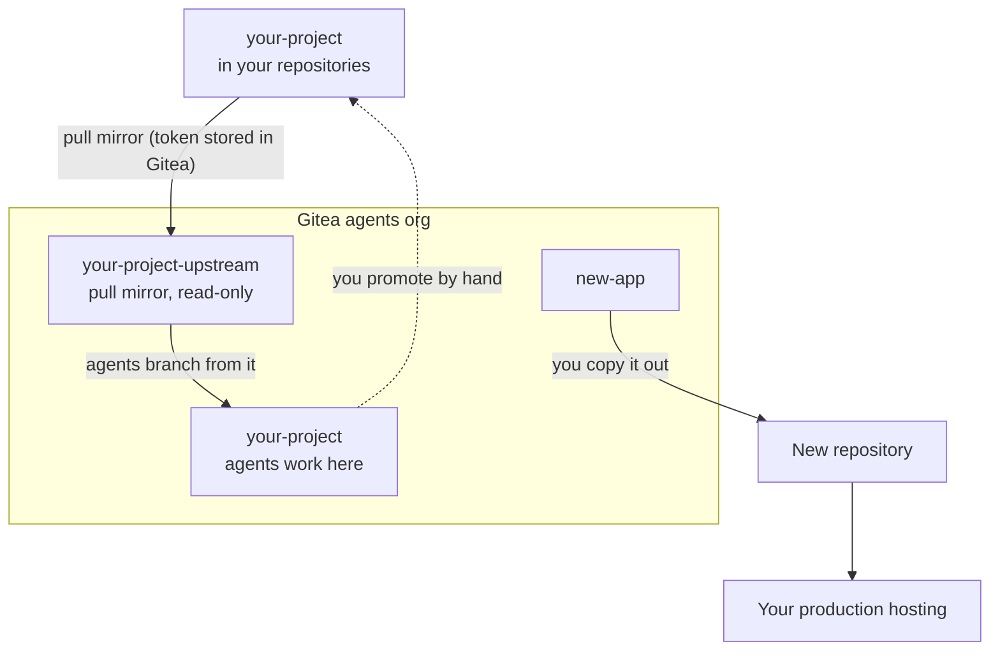

# Voliere design

Voliere turns one Proxmox host into an always-on workplace for coding agents.
You hand it a spec from any of your devices, worker agents build it, a reviewer
agent checks it, and Coolify deploys a preview you can open. Agents have full
privileges inside the sandbox, and every boundary sits where they can't reach
it.

## Principles

- **An agent will be compromised.** A prompt injection can arrive through
  anything an agent reads: an issue, a dependency, a web page, or a tool's
  output. Voliere plans for an attacker with root on both VMs, instead of
  relying on an agent or a model to resist.
- **Boundaries live outside the VMs.** The Proxmox firewall, the Tailscale ACL,
  Gitea permissions, and Cloudflare Access enforce every limit, with an
  upstream firewall as a second layer where you have one.
- **The host is disposable.** It has no backups or snapshots. You rebuild it
  from your configuration in under one hour.
- **Agents have full privileges inside their sandbox.** They run, commit,
  merge, and deploy without asking, within one Gitea org.

A compromised sandbox can reach only these things:

- The two VMs on the host.
- The agents org on your Gitea server, through two bot accounts.
- Preview apps in your preview zone.
- Your agents' subscriptions or API accounts, until you revoke the tokens.

It can't reach the host's local network, your other devices, your production
hosting, or your own repositories.

## Requirements

| Requirement                           | Used for                                         |
| ------------------------------------- | ------------------------------------------------ |
| A host that runs Proxmox VE           | The two VMs. The default sizes need 32 GB of RAM and 512 GB of disk. |
| A Tailscale tailnet                   | Private access and the network policy            |
| A Gitea server, 1.27.3 or later       | Repositories, issues, pull requests, and CI      |
| A Cloudflare zone for previews only   | Tunnel, TLS, and Access for preview apps         |
| Subscriptions or API keys for your agents | The worker and reviewer agents               |
| A secret source                       | 1Password, SOPS, or environment variables        |
| A workstation with OpenTofu and Ansible | Applying Voliere                               |

## Configuration

Voliere keeps code and configuration apart. This repository holds the code.
Your configuration lives in a private repository of your own:

- `site.yaml`: the preview zone, the Gitea URL, the tailnet, and notification
  URLs.
- `hosts/<name>.yaml`: VM sizes and the VM network for each host.
- OpenTofu state, encrypted.

Secrets never enter either repository. They reach OpenTofu and Ansible as
environment variables, and you choose how: `op run` for 1Password,
`sops exec-env` for SOPS, or your own shell.

## Architecture

Proxmox VE runs directly on the host and runs two Ubuntu 24.04 VMs. The
`agents` VM runs the agents. The `deploy` VM runs what agents build.

| Machine      | Default size             | Runs                                                      |
| ------------ | ------------------------ | --------------------------------------------------------- |
| Proxmox host | What the VMs leave       | Hypervisor and firewall.                                  |
| `agents`     | 14 GB, 4 vCPU, 200 GB    | T3 Code, agent CLIs, `tea`, mise toolchains.              |
| `deploy`     | 12 GB, 4 vCPU, 250 GB    | Coolify (Traefik), Gitea `act_runner`, `cloudflared`.     |

The VM network is a bridge to a local segment in a homelab, or a NAT bridge on
a cloud server with one public IP. Both VMs prune Docker images on a timer.

## Network boundaries

Two layers keep the VMs off every network except the internet:

- **The Proxmox firewall** lets the VMs reach the internet and blocks private
  ranges (RFC1918 and IPv6 ULA) and link-local addresses, including a cloud
  provider's metadata service. Voliere manages it, so it works on any host.
- **An upstream firewall**, where you have one, repeats that rule: a dedicated
  VLAN in a homelab, or the provider's firewall on a cloud server.

On a cloud server, the provider's firewall also blocks all inbound traffic to
the host. Tailscale still connects outbound, so you reach SSH and the Proxmox UI
only over the tailnet.

Tailscale traffic passes through both layers, so the Tailscale ACL is the
boundary for the tailnet:

| From               | To                           | Allowed                    |
| ------------------ | ---------------------------- | -------------------------- |
| Your devices       | Everything                   | All ports                  |
| `tag:voliere`      | Gitea server                 | Gitea HTTPS and Gitea SSH  |
| Gitea server       | `deploy` VM                  | Coolify webhook port only  |
| `tag:voliere`      | Anything else on the tailnet | Nothing                    |
| `tag:voliere-host` | Anything on the tailnet      | Nothing                    |

The tailnet needs no exit nodes or subnet routes for Voliere, and the ACL keeps
Voliere's tags from using any that exist.

## Gitea

Agents work only in one org on your Gitea server, `agents` by default.

- **`agent-bot`** is in a write team that can create repositories. It can't
  delete repositories or bypass branch protection.
- **`review-bot`** is in the `reviewers` team. Its approval counts toward the
  merge rule.
- **Branch protection on `main`** requires green CI and one approval from
  `reviewers`. New commits dismiss stale approvals. OpenTofu applies the rule
  to every repository in the org, so a new project becomes protected on the
  next `tofu apply`.

Gitea tokens can't be scoped to one org, so the bot accounts are the boundary:
neither bot belongs to anything outside the agents org.

Voliere doesn't back up Gitea. Back it up like any server you run, because it
holds all agent work.

## Agent workflow

T3 Code is the orchestrator. One lead thread turns your spec into issues, then
delegates each issue to a worker agent in its own worktree. A reviewer agent
checks each change and approves it through `review-bot`.

- The default pool is three workers and one reviewer. `site.yaml` sets which
  agent CLI fills each role, from those T3 Code supports.
- Questions reach you through the agent's question tool, which bumps the
  thread in T3.
- When an agent hits its usage limit, the thread pauses, notifies you, and
  resumes later.

## Deploys and previews

Coolify on the `deploy` VM builds every pull request and every merge to `main`.
These are meant to be staging deploys only. Production should never run in the sandbox.

- **Hostnames have one level**, because Cloudflare's Universal SSL covers only
  one level below the zone: `<app>.<zone>` for `main` and
  `<app>-pr<id>.<zone>` for previews. With more than one host, each host adds
  its name as a suffix.
- **Cloudflare Access protects the whole zone.** You sign in with your
  identity. Agents send a service token in the `CF-Access-Client-Id` and
  `CF-Access-Client-Secret` headers.
- **TLS ends at the Cloudflare edge**, so the host holds no DNS API token.
- **The Coolify dashboard** is reachable only on the tailnet.

## Project flows

Agents never touch your own repositories. You move code between the agents org
and your repositories by hand.

**One-off apps** start in the agents org from a template repository. When an
app is ready for production, push it to a repository your production hosting
deploys from.

**Ongoing projects** get a pull mirror named `<project>-upstream`. Agents work
in `<project>`. To promote work, follow these steps on your workstation:

1. Add the remote once: `git remote add agents <gitea-ssh-url>/agents/<project>.git`.
2. Fetch the work: `git fetch agents`.
3. Push the branch to your repository and open the pull request as yourself.

This step is slow by design. It keeps your CI secrets and deploy credentials
away from the agents. Have agents stack related work on one integration branch
so you promote once per batch.

## Credentials on the host

The host holds only the credentials it needs. Expect to rotate all of them
after a compromise.

| Credential                       | Where       | Grants                                  |
| -------------------------------- | ----------- | --------------------------------------- |
| Agent CLI logins or API keys     | `agents`    | Your agents' subscriptions or API accounts |
| `agent-bot` and `review-bot` tokens | `agents` | The agents org only                     |
| Gitea runner token               | `deploy`    | Running CI jobs                         |
| Coolify API token                | `agents`    | Managing staging apps                   |
| Cloudflare tunnel token          | `deploy`    | Serving the preview zone                |
| Cloudflare Access service token  | `agents`    | Opening preview apps                    |
| Skills deploy key (optional)     | `agents`    | Reading a private skills repository     |
| Tailscale node keys              | Both VMs    | Joining the tailnet as `tag:voliere`    |
| Notification URLs                | Both VMs    | Sending notifications                   |

## Infrastructure as code

You apply Voliere from your workstation. Ansible writes each secret only to
the VM that needs it.

| Tool                      | Manages                                                       |
| ------------------------- | ------------------------------------------------------------- |
| Proxmox install           | The automated installer with an answer file, or the provider's install method on a cloud server |
| OpenTofu (`bpg/proxmox`)  | The two VMs on each host                                      |
| OpenTofu                  | Tailscale ACL, Gitea org, teams, bots, and branch protection, Cloudflare tunnel and Access |
| Ansible                   | Host and VM configuration, Proxmox firewall, toolset, services, timers |
| niksi lockfile            | Agent skills installed on the `agents` VM                     |

Some steps stay manual: the upstream firewall, logging in to each agent CLI,
and pairing T3 with your devices.

### OpenTofu conventions

These conventions keep OpenTofu safe to run:

- **One root module per system:** `tofu/proxmox`, `tofu/tailscale`,
  `tofu/gitea`, and `tofu/cloudflare`. Each plan touches one system, so a
  mistake stays small.
- **One workspace per host** in `tofu/proxmox`, reading that host's file from
  your configuration. Adding a host means adding a file.
- **Secrets never touch disk.** They arrive as `TF_VAR_*` environment
  variables, and every secret variable is marked `sensitive`.
- **State is encrypted and kept in your configuration repository.** OpenTofu
  state encryption runs with `enforced = true`, so OpenTofu refuses to write
  plaintext state. With one operator, git is the backend and no locking is
  needed.
- **Versions are pinned:** OpenTofu itself through `required_version`, each
  provider, and the committed `.terraform.lock.hcl`.
- **Plan before apply.** Run `tofu plan -out=apply.tfplan`, read every resource
  marked for destroy or replace, then run `tofu apply apply.tfplan`.
- **Irreplaceable resources set `prevent_destroy`:** the Gitea org and the
  Cloudflare Access application.

## Toolset

The `agents` VM gets the following tools:

- **Runtimes through mise:** Node LTS, pnpm, Bun, Python with uv, Go, and Rust.
- **Build and deploy:** Docker and Compose, `tea`, worktrunk, and the Coolify
  API.
- **Search and checks:** ripgrep, fd, jq, yq, ast-grep, shellcheck, shfmt, and
  hyperfine.
- **Data and browsers:** sqlite3, psql, and Playwright with Chromium.
- **MCP:** Context7.

## Updates

Voliere pins anything that can break the agent workflow. Low-risk security
updates install themselves.

| Component              | Policy                                                  |
| ---------------------- | ------------------------------------------------------- |
| Ubuntu packages        | `unattended-upgrades`, security only. Reboots in a weekly window. |
| Tailscale, `cloudflared` | Automatic.                                            |
| Agent CLIs             | Their own auto-updater, or a weekly timer in the same window for CLIs without one. |
| T3 Code                | Pinned. Nightly until provider delegation ships in a stable release, then stable. |
| Coolify                | Pinned, auto-update off.                                |
| `act_runner`, OpenTofu providers, Ansible collections | Pinned.                  |
| Proxmox host           | Ansible, when you apply.                                |

Renovate keeps the pins in this repository current. You upgrade by moving to a
newer Voliere version and applying it. Apply T3 and Coolify upgrades when no
thread is working. If an automatic agent CLI update breaks T3, pin that CLI
too.

## Recovery

When something breaks or you suspect a compromise, follow these steps:

1. Revoke the credentials listed in
   [Credentials on the host](#credentials-on-the-host).
2. Reinstall Proxmox on the host.
3. Run `tofu apply` and the Ansible playbooks with fresh credentials.
4. Run the manual logins and pair T3 again.

Agent work survives on your Gitea server. Previews rebuild from there.

## Monitoring

- **ntfy** receives CI results and host health from systemd timers.
- **healthchecks.io** alerts you when the host stops checking in.
- **T3 Connect** is optional for agent events on your devices.
