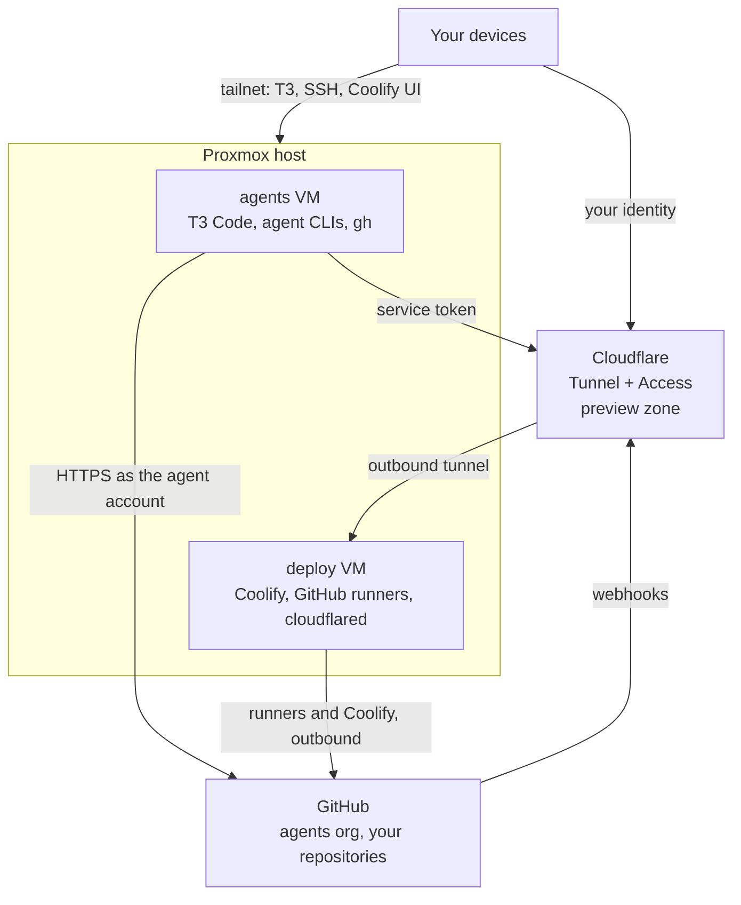
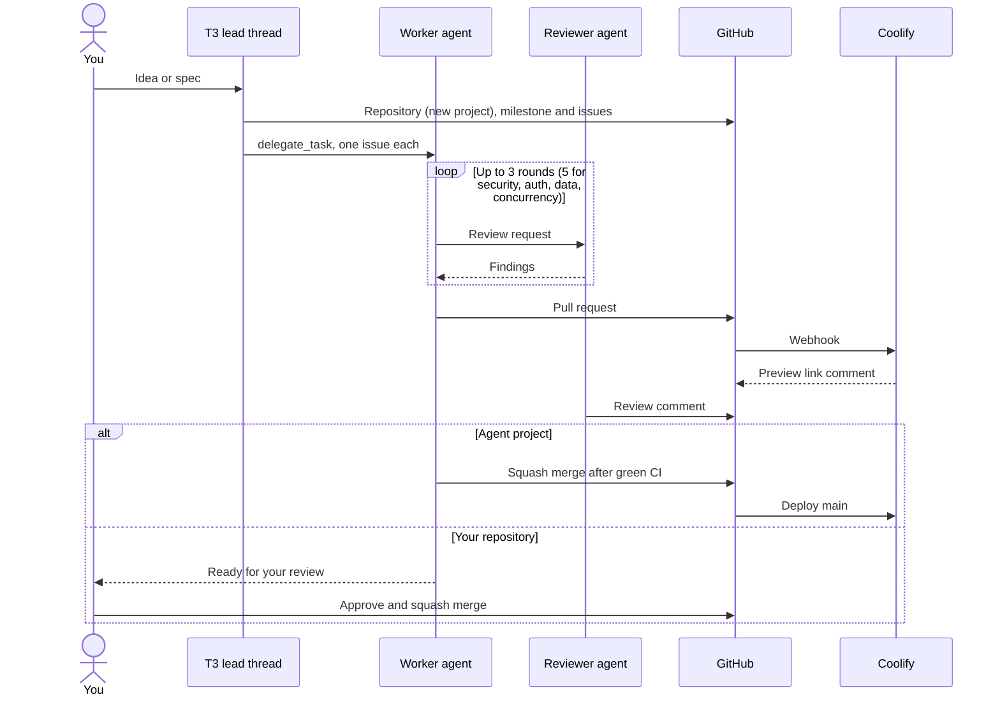
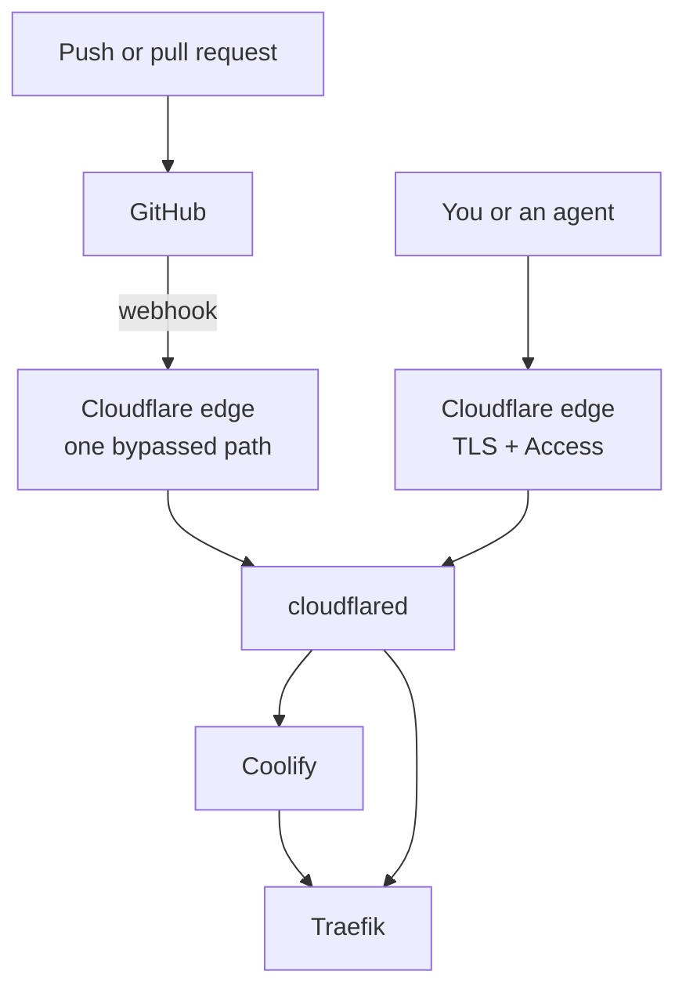
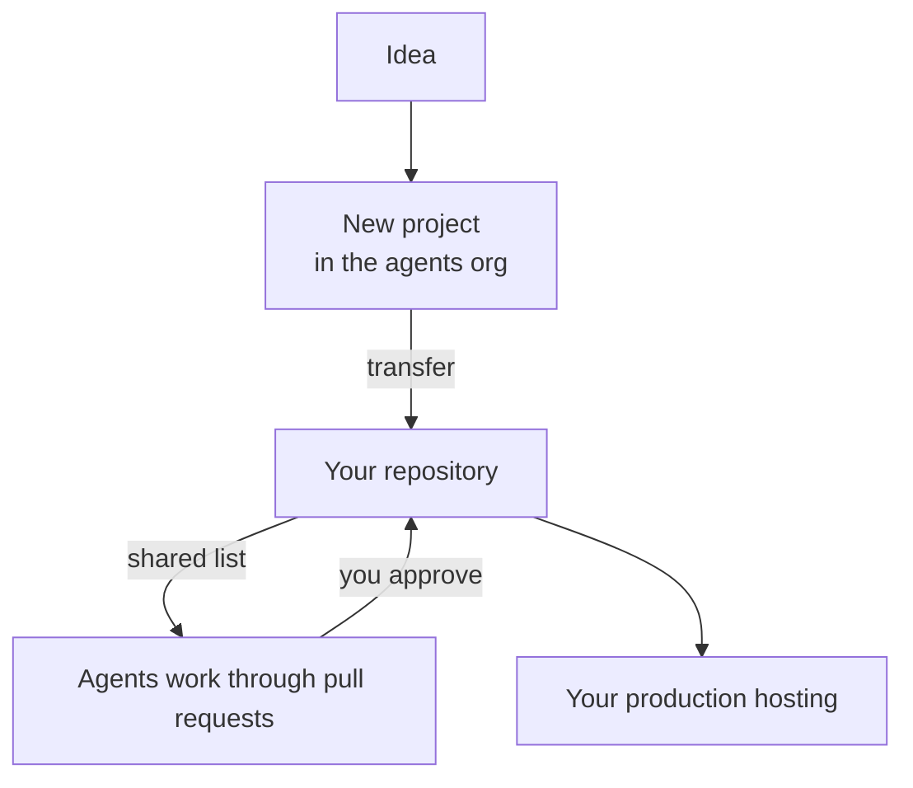

# Voliere design

Voliere turns one Proxmox host into an always-on workplace for coding agents.
You hand it an idea or a spec from any of your devices, worker agents build it
on GitHub, a reviewer agent checks it, and Coolify deploys a staging preview
you open through Cloudflare Access. Your laptop can sleep: the agents run on
the host, under their own GitHub account, with their own credentials.

## Principles

- **An agent will be compromised.** A prompt injection can arrive through
  anything an agent reads: an issue, a dependency, a web page, or a tool's
  output. Voliere plans for an attacker with root on both VMs, instead of
  relying on an agent or a model to resist.
- **Boundaries live outside the VMs.** The Proxmox firewall, the Tailscale ACL,
  GitHub permissions and rulesets, and Cloudflare Access enforce every limit,
  with an upstream firewall as a second layer where you have one.
- **The host is disposable.** It has no backups or snapshots. You rebuild it
  from your configuration in under one hour.
- **Agents have full privileges inside their sandbox.** They create
  repositories, commit, merge, and deploy without asking, within one GitHub
  org. On your own repositories they propose, and nothing merges without your
  approval.

A compromised sandbox can reach only these things:

- The two VMs on the host.
- Everything in the agents org.
- The repositories you share with the agent account: it can read them, push
  branches, and open pull requests. Their pull request CI runs its code, so
  shared repositories expose no secrets to pull request workflows.
- Preview apps in your preview zone.
- Your agents' subscriptions or API accounts, until you revoke the tokens.

It can't merge anything you didn't approve into your repositories, change
their workflows or settings, or reach repositories you didn't share. It can't reach the host's local
network, your other devices, your tailnet, or your production hosting.

## Requirements

| Requirement                           | Used for                                         |
| ------------------------------------- | ------------------------------------------------ |
| A host that runs Proxmox VE           | The two VMs. The default sizes need 32 GB of RAM and 512 GB of disk. |
| A Tailscale tailnet                   | Private access to the VMs, T3 Code, and Coolify   |
| A GitHub account on GitHub Pro        | Rulesets on your private repositories             |
| A GitHub org, free plan               | The agents' repositories                          |
| A GitHub machine account              | The agents' identity                              |
| A public GitHub template repository   | The starting files and CI workflow of every project |
| A Cloudflare zone for previews only   | Tunnel, TLS, and Access for previews and webhooks |
| Subscriptions or API keys for your agents | The worker and reviewer agents               |
| A secret source                       | 1Password, SOPS, or environment variables        |
| A workstation with OpenTofu and Ansible | Applying Voliere                               |

GitHub's terms allow one free machine account per person, in addition to your
personal account.

## Configuration

Voliere keeps code and configuration apart. This repository holds the code.
Your configuration lives in a private repository of your own:

- `site.yaml`: the preview zone, the webhook hostname, your GitHub account,
  the agents org, and the agent account.
- `hosts/<name>.yaml`: VM sizes and the VM network for each host.
- OpenTofu state, encrypted.

Secrets never enter either repository. They reach OpenTofu and Ansible as
environment variables, and you choose how: `op run` for 1Password,
`sops exec-env` for SOPS, or your own shell. The ntfy topic and the
healthchecks.io ping key count as secrets: whoever knows them can read your
alerts or fake a machine's check-ins.

## Architecture

Proxmox VE runs directly on the host and runs two Ubuntu 26.04 VMs. The
`agents` VM runs the agents. The `deploy` VM runs CI and what agents build.

| Machine      | Default size             | Runs                                                      |
| ------------ | ------------------------ | --------------------------------------------------------- |
| Proxmox host | What the VMs leave       | Hypervisor and firewall.                                  |
| `agents`     | 14 GB, 4 vCPU, 200 GB    | T3 Code, agent CLIs, `gh`, mise toolchains.               |
| `deploy`     | 12 GB, 4 vCPU, 250 GB    | Coolify (Traefik), two GitHub Actions runners, `cloudflared`. |

The VM network is a bridge to a local segment in a homelab, or a NAT bridge on
a cloud server with one public IP. Both VMs prune Docker images on a timer.

## Network boundaries

Two layers keep the VMs off every network except the internet:

- **The Proxmox firewall** lets the VMs reach the internet and blocks private
  ranges (RFC1918, CGNAT, and IPv6 ULA) and link-local addresses, including a
  cloud provider's metadata service. Voliere manages it, so it works on any
  host.
- **An upstream firewall**, where you have one, repeats that rule: a dedicated
  VLAN in a homelab, or the provider's firewall on a cloud server.

On a cloud server, the provider's firewall also blocks all inbound traffic to
the host. Tailscale still connects outbound, so you reach SSH and the Proxmox UI
only over the tailnet.

Tailscale traffic passes through both layers, so the Tailscale ACL is the
boundary for the tailnet:

| From               | To                           | Allowed                    |
| ------------------ | ---------------------------- | -------------------------- |
| Your devices       | Everything                   | All ports                  |
| `tag:voliere`      | Anything on the tailnet      | Nothing                    |
| `tag:voliere-host` | Anything on the tailnet      | Nothing                    |

Nothing reaches the VMs from the internet except through the Cloudflare
tunnel, which carries two things: previews behind Access, and GitHub's
webhooks for Coolify on one path of one hostname.

The tailnet needs no exit nodes or subnet routes for Voliere, and the ACL keeps
Voliere's tags from using any that exist.

OpenTofu creates the join keys for the host and the VMs with a Tailscale OAuth
client tagged `tag:voliere-provisioner`. Tailscale lets a client create keys
only for tags it owns, so the policy makes `tag:voliere-provisioner` an owner
of `tag:voliere` and `tag:voliere-host`. No device carries the provisioner tag,
so it appears in no grant.

## GitHub

Agents work as one machine account. Where it can write decides what a
compromise costs.

### The agent account

- **One identity for every agent.** The worker and reviewer agents share the
  account, so GitHub can't tell them apart. Its approval would count for
  nothing on its own pull requests anyway: GitHub lets no account approve its
  own work.
- **A classic token with the `repo` and `read:org` scopes**, and without
  `workflow`. GitHub refuses its pushes that change a workflow file, so the
  agents can't change your repositories' CI. In the org, where the account is
  admin, this is a speed bump, not a boundary.
- **HTTPS only.** Git pushes with the same token, through `gh` as git's
  credential helper. The account has no SSH key, which would skip the
  workflow check.
- **Unsigned branch commits.** The account holds no signing key. Commits on
  `main` are signed by GitHub when a pull request is squash-merged, and
  rulesets allow squash merges only.

### The agents org

- **The agent account is a member and creates its own repositories.** A free
  org can't limit members to private repositories. The account is admin of
  each repository it creates, which is fine: the org holds nothing that isn't
  already the agents'.
- **Members see only the repositories they create or are given.**
- **No branch protection.** The free plan has none for private repositories.
  Agents merge their own pull requests after green CI and a clean review, by
  instruction. Nothing outside the org depends on that.
- **Projects start from a public template repository of yours**, your
  scaffold, which carries your defaults and the CI workflow. GitHub lets only
  its owner use a private template that belongs to a personal account, so the
  template must be public. Only you write to it.
- **The `ci` repository** holds the reusable workflows that every project
  calls. It's public, so your own repositories can call it too, and it holds
  no secrets. Only OpenTofu writes to it.

### Your repositories

- **You share a repository by adding it to a list** in your configuration.
  OpenTofu creates the ruleset first, then invites the agent account as a
  collaborator with push access and accepts the invitation as the agent
  account.
- **A ruleset guards the default branch** of each shared repository:
  - a pull request with one approval, from someone other than the author
  - approval of the latest push, so a push after your approval needs a new one
  - squash merges only, no force pushes or deletion
  - the status checks you list for that repository
- **You bypass the ruleset** as the repository's admin, so your own pushes to
  `main` work as before.
- **The agents stop at a ready pull request** and leave the merge to you, by
  instruction. A compromised agent could press merge after your approval, but
  only on the exact content you approved.
- **No signed-commit rule.** GitHub checks every commit on a pull request's
  branch against it, so the agent's unsigned commits would block each merge.
  `main` stays signed anyway: GitHub signs squash commits, and your own pushes
  are signed.
- **CI on your repositories runs on GitHub's runners**, never on the org's
  runners on the `deploy` VM.
- **Public repositories take instructions only from you.** Agents treat issues
  and comments from anyone else as data, and act only on issues you wrote or
  labelled.

## Agent workflow

T3 Code is the orchestrator. One lead thread turns your idea or spec into
issues, then delegates each issue to a worker agent in its own worktree. A
reviewer agent checks each change and posts its verdict on the pull request.

- The default pool is three workers and one reviewer. T3 Code's settings set
  which agent CLI fills each role. Voliere installs Claude Code and Codex.
- Questions reach you through the agent's question tool, which bumps the
  thread in T3.
- When an agent hits its usage limit, the thread pauses, notifies you, and
  resumes later.
- A spec can make an agent project manual, so agents stop before merging, as
  on your repositories.

## CI

- **Projects carry one thin workflow** that calls a reusable workflow in the
  `ci` repository. A change to CI is one edit there, and every project picks
  it up on its next run.
- **The reusable workflow runs the project's `ci` task** from `mise.toml`,
  after installing the project's mise tools. Agents change a project's checks
  there, since their token can't change workflow files. It works for any
  language.
- **The reusable workflow picks the runner by owner.** Jobs from the agents
  org run on the org's runners on the `deploy` VM, which saves Actions
  minutes. Jobs from any other owner, such as a graduated project, run on
  GitHub's runners.
- **The org's runners serve private repositories only.** That's the default
  for an org's runner group, so a stranger's pull request on a public org
  repository never reaches the `deploy` VM. The `ci` repository is public, and
  holds only workflows that other repositories call.
- **Jobs run as an unprivileged user** on the `deploy` VM, with no Docker and
  no sudo. They can't control Coolify's containers or read its keys.
- **Agent CI uses no secrets.** Workflows get a read-only token. Deploy
  credentials live in Coolify, never in Actions.

## Deploys and previews

Coolify on the `deploy` VM builds every pull request and every merge to `main`,
through Coolify's own GitHub App. These are staging deploys only. Production
should never run in the sandbox.

- **Two Coolify GitHub App sources**, because a private GitHub App installs
  only on the account that owns it. The org's app is installed on every
  repository of the agents org, so new projects are covered. Your account's
  app is installed on the shared repositories you pick. Both read code and
  comment preview links on pull requests, and both deliver webhooks to the
  same Coolify path.
- **One Coolify app per project.** The lead asks you for it when it creates a
  project. You create it with an interactive script from your workstation on
  the tailnet, which calls Coolify's API, or from the Coolify dashboard on any
  of your devices.
- **Hostnames have one level**, because Cloudflare's Universal SSL covers only
  one level below the zone: `<app>.<zone>` for `main` and
  `<app>-pr<id>.<zone>` for previews. With more than one host, each host adds
  its name as a suffix.
- **Cloudflare Access protects the whole zone.** You sign in with your
  identity. Agents send a service token in the `CF-Access-Client-Id` and
  `CF-Access-Client-Secret` headers.
- **GitHub's webhooks bypass Access** on Coolify's GitHub webhook path of one
  hostname, because GitHub can't sign in. Coolify checks each delivery's
  signature. Every other Coolify path stays on the tailnet.
- **TLS ends at the Cloudflare edge**, so the host holds no DNS API token.

## Project flows

**New ideas** start in the agents org. The lead creates the repository from
the template, and you create its Coolify app. From then on, every pull
request has a preview and `main` deploys to staging.

**Graduating a project** means transferring the repository to your account
with GitHub's transfer, which keeps its issues and pull requests. Then add it
to your shared list, so the agents keep working on it through pull requests,
and move its Coolify app to your account's GitHub App source. Its CI moves to
GitHub's runners without a change.

**Existing projects** join the shared list directly. Agents clone them, push
branches, and open pull requests. You review, approve, and merge.

## Credentials on the host

The host holds only the credentials it needs. Expect to rotate all of them
after a compromise.

| Credential                       | Where       | Grants                                  |
| -------------------------------- | ----------- | --------------------------------------- |
| Agent CLI logins or API keys     | `agents`    | Your agents' subscriptions or API accounts |
| Agent account's GitHub token     | `agents`    | The agents org, and branches and pull requests on shared repositories |
| Runner registrations             | `deploy`    | Running the agents org's CI jobs        |
| Coolify's GitHub App keys        | `deploy`    | Reading installed repositories, commenting on pull requests |
| Cloudflare tunnel token          | `deploy`    | Serving the preview zone                |
| Cloudflare Access service token  | `agents`    | Opening preview apps                    |
| Tailscale node keys              | Host and both VMs | Joining the tailnet as `tag:voliere-host` or `tag:voliere` |
| ntfy topic, healthchecks.io ping key | Host and both VMs | Sending alerts and check-ins      |

## Infrastructure as code

You apply Voliere from your workstation. Ansible writes each secret it
handles only to the machine that needs it. The agent logins and tokens go
into one environment file on the `agents` VM by hand.

| Tool                      | Manages                                                       |
| ------------------------- | ------------------------------------------------------------- |
| Proxmox install           | The automated installer with an answer file, or the provider's install method on a cloud server |
| OpenTofu (`bpg/proxmox`)  | The two VMs on each host                                      |
| OpenTofu                  | Tailscale ACL; the agents org's settings, membership, and `ci` repository; shared repositories and their rulesets; Cloudflare tunnel and Access |
| Ansible                   | Host and VM configuration, Proxmox firewall, toolset, runners, services, timers |
| niksi lockfile            | Agent skills installed on the `agents` VM                     |

Some steps stay manual:

- the upstream firewall and the Proxmox API token
- the GitHub org, the agent account, both GitHub tokens, and accepting the org
  invitation as the agent account
- a runner registration token on each build, valid for one hour
- the Coolify admin account, both GitHub App sources, and one Coolify app per
  project
- logging in to each agent CLI, the environment file on the `agents` VM, and
  pairing T3 with your devices
- the ntfy topic and the healthchecks.io checks

New projects need no OpenTofu at all.

### OpenTofu conventions

These conventions keep OpenTofu safe to run:

- **One root module per system:** `tofu/proxmox`, `tofu/tailscale`,
  `tofu/github`, and `tofu/cloudflare`. Each plan touches one system, so a
  mistake stays small.
- **One workspace per host** in `tofu/proxmox`, reading that host's file from
  your configuration. Adding a host means adding a file.
- **Secrets never touch disk.** They arrive as environment variables, and
  every secret variable is marked `sensitive`.
- **State is encrypted and kept in your configuration repository.** OpenTofu
  state encryption runs with `enforced = true`, so OpenTofu refuses to write
  plaintext state. With one operator, git is the backend and no locking is
  needed.
- **Versions are pinned:** OpenTofu itself through `required_version`, each
  provider, and the committed `.terraform.lock.hcl`.
- **Plan before apply.** Run `tofu plan -out=apply.tfplan`, read every resource
  marked for destroy or replace, then run `tofu apply apply.tfplan`.
- **Irreplaceable resources set `prevent_destroy`:** the Cloudflare Access
  application.

## Toolset

The `agents` VM gets the following tools:

- **Runtimes through mise:** Node LTS, pnpm, Bun, Python with uv, Go, and Rust.
- **Build and deploy:** Docker and Compose, `gh`, and worktrunk.
- **Search and checks:** ripgrep, fd, jq, yq, ast-grep, shellcheck, shfmt, and
  hyperfine.
- **Data and browsers:** sqlite3, psql, and Playwright with Chromium.
- **MCP:** Context7.

## Updates

Voliere pins anything that can break the agent workflow. Low-risk security
updates install themselves.

| Component              | Policy                                                  |
| ---------------------- | ------------------------------------------------------- |
| Ubuntu packages        | `unattended-upgrades`, security only. Reboots in a weekly window. |
| Tailscale, `cloudflared` | Automatic.                                            |
| GitHub Actions runners | Their own updater, which GitHub requires.               |
| Agent CLIs             | Their own auto-updater, or a weekly timer in the same window for CLIs without one. |
| T3 Code                | Pinned. Nightly until provider delegation ships in a stable release, then stable. |
| Coolify                | Pinned, auto-update off.                                |
| `gh`, OpenTofu providers | Pinned.                                       |
| Proxmox host           | Ansible, when you apply.                                |

Renovate keeps the pins in this repository current. You upgrade by moving to a
newer Voliere version and applying it. Apply T3 and Coolify upgrades when no
thread is working. If an automatic agent CLI update breaks T3, pin that CLI
too.

## Recovery

When something breaks or you suspect a compromise, follow these steps:

1. Revoke the credentials listed in
   [Credentials on the host](#credentials-on-the-host). For the agent
   account, also review its recent pushes and the agents org's repositories.
2. Reinstall Proxmox on the host.
3. Run `tofu apply` and the Ansible playbooks with fresh credentials.
4. Run the manual logins and pair T3 again.

Agent work survives on GitHub. Previews rebuild from there.

## Monitoring

Every machine runs a health check every 15 minutes from a systemd timer.

- **ntfy** gets a notification when the check's findings change: a full disk,
  a failed unit, a stopped service or runner, or a known hardware error in the
  kernel log.
- **healthchecks.io** gets a check-in from every run, with one check per
  machine. When check-ins stop because a machine or its network is down,
  healthchecks.io alerts you.
- **GitHub** notifies you of pull requests waiting for your review and of
  failed CI, on the web and in its mobile app.
- **T3 Connect** is optional for agent events on your devices.
